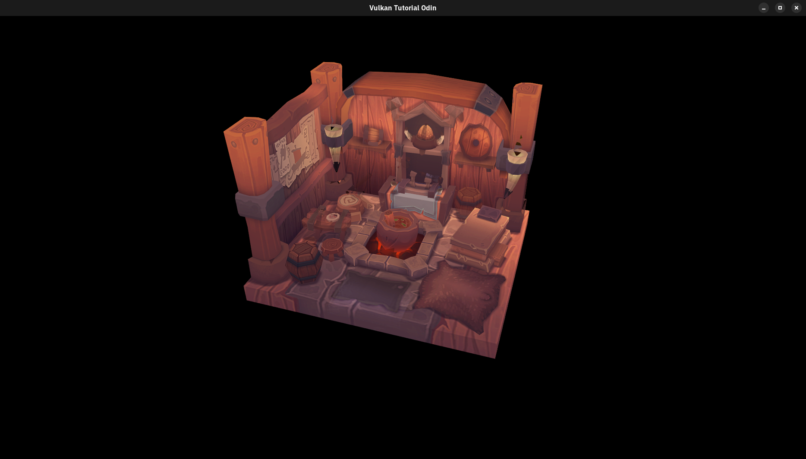

# Vulkan tutorial in Odin

This is more of a playground of mine and I am using it to learn Vulkan and the Odin programming language. At this moment the project is ongoing a refactor into something more modular and reusable (the `ovk` library).

# References

- [Vulkan Tutorial](https://vulkan-tutorial.com/)
- [Odin Programming Language](https://odin-lang.org/)
- [Odin Vulkan Tutorial](https://hilderin.github.io/OdinVulkan/)
- [Vulkan Specification](https://www.khronos.org/registry/vulkan/specs/1.3-extensions/html/vkspec.html)
- [Learn OpenGL](https://learnopengl.com/)
